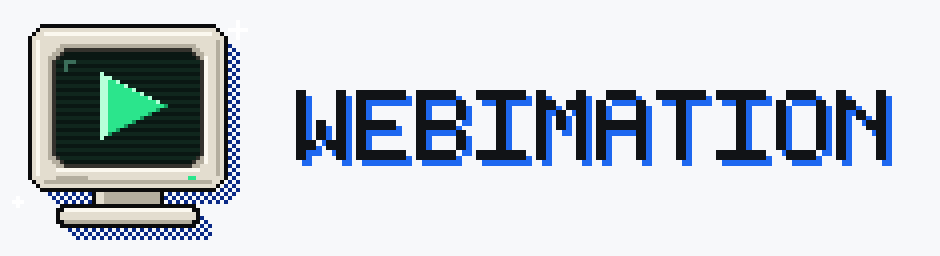

# Webimation

<p align="center"></p>

**Motion graphics for video creators, ready to drop into any editor.**

## What it's for

Most motion graphics tools are built for motion designers: timelines, keyframes, expressions, a steep learning curve. Most template packs are the opposite: fixed, hard to restyle, and locked to one editor.

Webimation sits between the two. The goal is that someone making videos can:

1. **Pick** from a big library of finished graphics, shapes, stick-figure scenes and animations, each one already well made.
2. **Change** the words, colours, fonts and motion until it fits their video, without learning animation.
3. **Export** it as a real transparent video file (or a ready-placed timeline) that works in **Premiere Pro, DaVinci Resolve, Final Cut Pro, CapCut** and anything else that can layer video.

Three principles drive the design:

- **Editor-agnostic output.** Nothing is tied to one editor. You get ProRes 4444, WebM, PNG sequences and FCPXML / Premiere XML timelines.
- **Exact, repeatable frames.** Every graphic is a pure function of time, so scrubbing, looping and export always agree, and 4K is rendered as vector at the output size, never upscaled.
- **Calm, precise tools.** A light interface with one highlight colour, hard-edged motion with no mush, and a 90s pixel-art identity.

Webimation is a desktop app for **macOS, Windows and Linux**, built with [Tauri](https://tauri.app). The UI is the web code in `src/`; `src-tauri/` is the native shell.

**New to Webimation? Start with the [user guide](docs/USER_GUIDE.md).** It walks through everything from installing to dropping your export into a video editor.

## Run it

You need Node 20.19+ and Rust (stable). Linux also needs the WebKitGTK dev packages; see the [Tauri prerequisites](https://tauri.app/start/prerequisites/). Video export uses **ffmpeg** if it's installed (`brew install ffmpeg` · `winget install ffmpeg` · `sudo apt install ffmpeg`); PNG sequences work without it.

```sh
npm install
npm run app          # desktop app with hot reload
npm run app:build    # installers for the platform you're on → src-tauri/target/release/bundle/
npm run dev          # same UI in a browser at http://localhost:5173
npm test             # engine + stick-figure tests
npm run icons        # regenerate every app icon from assets/logo/build.py
```

### Installers for every platform

`.github/workflows/desktop.yml` builds on macOS (universal), Windows and Linux on every push. The installers appear under the run's **Artifacts**: `.dmg`/`.app`, `.msi`/`.exe`, `.deb`/`.rpm`/`.AppImage`. Push a `v*` tag (for example `v0.1.0`) and it also drafts a GitHub release with all of them attached.

The builds aren't code-signed yet. The first time you open it, macOS needs **right-click → Open** and Windows SmartScreen needs **More info → Run anyway**. To sign, add the Apple and Windows certificates as repository secrets and pass them to `tauri-action`. See Tauri's signing guides for [macOS](https://tauri.app/distribute/sign/macos/) and [Windows](https://tauri.app/distribute/sign/windows/).

## The Studio

Left: what you can add (**Graphics**, **Shapes**, **Characters**). Middle: preview, timeline and transcript. Right: settings for the selection (**Content**, **Style**, **Motion**, **Export**). The top bar switches between **Timeline** (a whole episode) and **Single** (one animation on its own).

**Stacking.** Several graphics can be on screen in the same frame. Adding something where a graphic is already showing puts it on a new layer above. Timeline rows are layers: drag clips up or down to restack. Only the bottom graphic draws its background. Overlapping graphics preview and export together as one stack. The rules live in `src/studio/stack.ts`.

The project autosaves on this computer.

### Graphics, shapes and stick figures

- **15 graphic templates**: lower third, chapter card, stat, ranking, checklist, subscribe, title, quote, versus, steps, location, breaking bar, definition, countdown and poll.
- **25 shapes** in six groups:
  - Arrows: straight, curved, swoop, elbow, block, double
  - Lines: underline, strike, divider
  - Callouts: leader label, speech bubble, map pin, step marker
  - Frames: highlight box, corner brackets, bracket, circle, spotlight
  - Marks: check/cross, burst, star, crosshair, cursor
  - Badges: tag, progress bar

  Shapes are parametric (length, angle, bend, weight, head style…). Strokes draw on, and heads land as their line arrives.
- **Stick figures**: no rigging needed. Each figure follows a script of steps: walk, run, sneak, jump, wave, point, cheer, clap, think, shrug, facepalm, celebrate, dance, bow, sit, get up, fall, kick, punch, look out, surprise, or a custom pose. Each step has its own duration, distance, speech bubble and facing. Scenes can have up to six figures, and there are seven ready-made scenes.

### Style

Every graphic has its own:

- **Type**: 17 bundled typefaces in 17 pairings across four roles (headline, body, label, numerals). Each role can override font, weight, width, tracking, size and case.
- **Colour**: palette or custom accent, nine fields, grid lines, and text and plate colours.
- **Placement**: a 9-point anchor in the title-safe area, size, and pixel nudge.

### Transitions

Open **Transitions** in the top bar, the **Fades** tab on the left, or press `T`. There are 14 dithered covers and reveals for hiding a cut, in two families:

- **Pixel field** (6): Tide, Eclipse, Aperture, Blade, Rise and Tide reveal. A hard-edged shape sweeps the frame, leaving a noise-dithered fill with a bright rim and a stipple halo, drawn in chunky blocks.
- **ASCII glyphs** (8): ASCII sweep, Terminal green, Binary rain, Static and more. A grid of glyphs (ASCII, code, binary, ordered-dither pixels or halftone dots) covers or uncovers the picture.

Each one can be a **cover**, a **reveal** or **cover + reveal** (clear → solid → clear, with the cut hidden in the solid middle). You can edit direction, shape or sweep, glyph set, colours (four for pixel fields, glyph and fill for ASCII), glyph font (any of the 17 bundled fonts), cell size, softness, shimmer, length and hold. Edits are remembered per transition, and **Reset to preset** undoes them.

Transitions export with **real transparency**: ProRes 4444, PNG sequence or WebM, up to 4K. Every transition is fully clear on its first frame and fully covered on its last, so it cuts cleanly. The rules are in `src/engine/dither.ts` and `src/engine/pixelField.ts`, and both are pure functions of time.

### Motion library and Lab

There are **438 built-in presets** across 45 effect families. Library cards show a still frame and play from the first frame when you hover. Press `/` to search (several words work, name matches come first, **Enter** applies the top result), star animations into **Favourites**, and find what you used lately in **Recent**. **Animate all** plays every card. Click a preset to load it into the **Motion Lab**, or double-click to apply it. In the Lab you can:

- set the enter and exit effects and their parameters
- pick the curve (quart-out, in-out, linear, or 4/8/16 hard steps)
- set the stagger order and spread, cue gap, pace, exit length and exit stagger
- preview on a specimen or on the selected graphic, with scrubbing
- **Mint new**: roll a fresh recipe from the whole effect space (every seed gives a different animation)
- save custom presets, and export or import them as `.webimation.json`

### Export

Use **Export graphic** or **Export all** in the inspector to choose:

| Format | Alpha | Use |
|---|---|---|
| ProRes 4444 `.mov` | yes | Premiere, Resolve, Final Cut: drop it on a track above your footage |
| PNG sequence | yes | Any editor, no ffmpeg needed |
| WebM VP9 | yes | Web, CapCut |
| MP4 H.264 | no | Quick previews, uploads |

**Export timeline for editor** (Export tab, desktop app) writes one folder with every graphic as a transparent ProRes `.mov`, plus a `.fcpxml` (DaVinci Resolve, Final Cut Pro), a `.xml` (Premiere Pro, Resolve) and a `README.txt`. Each clip is already placed at its time on your Webimation timeline. Graphics that overlap in time are rendered together as one stack. Open the file in your editor and everything lands in position.

Sizes go from 720p up to 4K, at 24, 25, 30, 50 or 60 fps. Frames are rendered as vector at the output size, so 4K isn't upscaled. The browser build exports a PNG sequence as a `.zip`.

## Engine (`src/engine`)

Every frame is a pure function of time, so graphics scrub, loop and export frame-exact. Enters are quart-out and exits are cubic-in. Reveals use hard edges: no fades, no springs, no drift.

| File | What it does |
|---|---|
| `effects.ts` | Effect families. Each one turns enter/exit progress into clip-paths, transforms or glyph swaps on a target. |
| `presets.ts` | Preset recipes, the minted library, signature set, custom store, seeded `mint()` and JSON `sanitize()`. |
| `templates.ts` | Graphic templates built from `R(start, dur, html)` reveal cues. |
| `stage.ts` | `createStage(host)` → `show(clip, localTime, { transparent })`. Wires each cue to the clip's preset, type, colour and placement. |
| `target.ts` | Revealable element: clip bleed, device-pixel-snapped clip paths, and text splitting that keeps kerning and baselines. |
| `fonts.ts`, `look.ts` | Type roles and pairings; colours, fields and placement. |
| `shapes.ts`, `shapeRender.ts` | Parametric shape geometry and its draw-on animation. |
| `stick.ts`, `stickRender.ts` | Stick-figure rig, actions, IK gaits, step blending, and drawing. |
| `dither.ts`, `pixelField.ts` | ASCII-glyph and pixel-field transitions: cell coverage, Bayer thresholds, glyph atlas, palettes, rasterisers, presets. |
| `raster.ts` | Off-screen frame rasteriser used by export (fonts embedded, alpha preserved). |

**Precision checks.** These run in headless Chromium and WebKit:

- Every glyph's rest position sits within 1/16 px of the untouched layout (measured worst: 0.05 px). This covers every text effect × font pairing × placement × template, at two stage scales, in Chromium and WebKit at 1x and 2x: 137,088 cases (`npm run audit:precision`).
- Exits leave nothing visible on a clip's first and last frames.
- In the stick-figure tests, no body part goes below the floor and planted feet never slide, for every pair of actions in both facings.

**Adding an effect:** add an `EffectDef` to `effects.ts` with `params` options. The library mints a preset for every combination. `make(target, params, ctx)` returns `(k, x) => void`, where `k` and `x` are linear enter and exit progress. The frame where `k = 1, x = 0` must leave the element untouched.

**Adding a graphic:** add a `Template` to `templates.ts`. Wrap each revealable element in `R(start, dur, html)`, and use `fx: 'wipe'` for thin decor. Use the type roles (`SANS`, `SERIF`, `CAPS`, `NUM`) and colour variables (`var(--w-fg)`, `var(--w-plate)`…) so the style controls apply.

**Adding a stick-figure action:** add an `ActionDef` to `stick.ts`. Keyframed actions are `[u, pose]` lists; moving actions return the hip offset too.

## Logo

`assets/logo/build.py` draws the pixel-art mark: a chunky 90s CRT monitor with a big play button, a checkerboard-dithered drop shadow and pixel sparkles on a blue tile. It's drawn on an exact 64×64 grid and writes:

- `Webimation.icon`: the Icon Composer bundle. It's layered for macOS 26 Liquid Glass, and `npm run icons` compiles it with `actool`.
- `app-icon.svg`, `logo.svg`, and the light and dark lockups.

**Docs screenshots:** `node scripts/docs-screenshots.mjs` (with `npm run dev -- --port 5179` running) regenerates `docs/images`.
