# Webimation user guide

Webimation makes animated graphics for videos: name titles, big numbers, chapter cards, arrows, callouts and simple animated characters. You build them here, export them as video files, and put them on top of your footage in your normal video editor.

This guide starts from nothing. You don't need any animation or design experience.

**Contents**

1. [Install and open the app](#1-install-and-open-the-app)
2. [A quick look around](#2-a-quick-look-around)
3. [Your first graphic in five minutes](#3-your-first-graphic-in-five-minutes)
4. [Changing the words](#4-changing-the-words)
5. [Changing how it looks](#5-changing-how-it-looks)
6. [Changing how it moves](#6-changing-how-it-moves)
7. [Shapes: arrows, boxes and callouts](#7-shapes-arrows-boxes-and-callouts)
8. [Characters](#8-characters)
9. [Stacking several things in the same frame](#9-stacking-several-things-in-the-same-frame)
10. [Checking it on your own video](#10-checking-it-on-your-own-video)
11. [Timeline and Single](#11-timeline-and-single)
12. [Exporting](#12-exporting)
13. [Putting it into your video editor](#13-putting-it-into-your-video-editor)
14. [Saving your work](#14-saving-your-work)
15. [Keyboard shortcuts](#15-keyboard-shortcuts)
16. [Problems and fixes](#16-problems-and-fixes)
17. [Words used in this guide](#17-words-used-in-this-guide)

---

## 1. Install and open the app

Webimation runs on Mac, Windows and Linux.

**Get the installer.** Use the file you were given, or download it from the project's GitHub page: open **Actions**, click the most recent run with a green tick, and scroll to **Artifacts**. Pick the one for your computer:

| Computer | Download | File to open |
|---|---|---|
| Mac | `webimation-macos` | `.dmg` |
| Windows | `webimation-windows` | `.msi` or `.exe` |
| Linux | `webimation-linux` | `.AppImage`, `.deb` or `.rpm` |

**Install it.**

- **Mac:** open the `.dmg` and drag Webimation into Applications. The first time, macOS may say it can't check the app. Right-click Webimation in Applications, choose **Open**, then **Open** again. You only need to do this once.
- **Windows:** run the installer. If Windows shows "Windows protected your PC", click **More info**, then **Run anyway**.
- **Linux:** make the `.AppImage` executable and run it, or install the `.deb`/`.rpm` with your package manager.

These warnings appear because the app isn't signed by Apple or Microsoft yet. They don't mean anything is wrong with it.

**Optional: install ffmpeg.** Webimation can always export PNG image sequences. To export video files (ProRes, WebM, MP4) it uses a free tool called ffmpeg:

- Mac: install [Homebrew](https://brew.sh), then run `brew install ffmpeg` in Terminal.
- Windows: run `winget install ffmpeg` in a Command Prompt.
- Linux: `sudo apt install ffmpeg` (or your distribution's equivalent).

Restart Webimation afterwards.

## 2. A quick look around

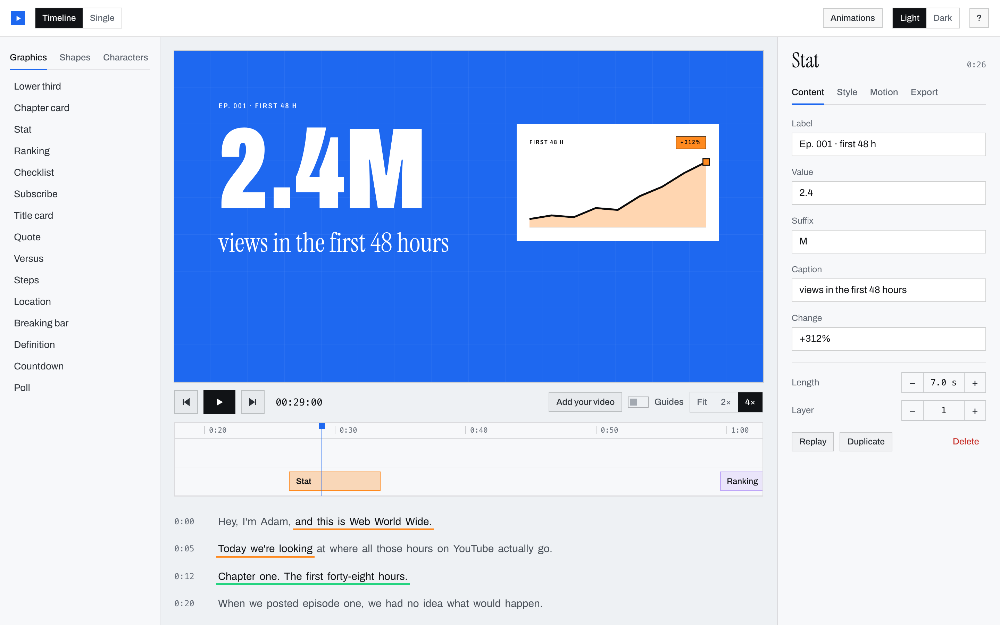

The window has five parts:

- **Left: what you can add.** Three tabs: **Graphics**, **Shapes** and **Characters**. Click any item to add it.
- **Middle: the preview.** This is what your viewer will see. Below it are the play controls.
- **Below the preview: the timeline.** Each block is one graphic. Left to right is time. Rows are layers: higher rows sit on top.
- **Bottom: the transcript.** Click any word to add a graphic at the moment that word is spoken.
- **Right: settings for whatever is selected.** Four tabs: **Content**, **Style**, **Motion** and **Export**.

Along the top: **Timeline / Single** switches between working on a whole video and working on one animation at a time (see [section 11](#11-timeline-and-single)). **Animations** opens the full list of animation styles. **Light / Dark** changes the app's colours. **?** shows the quick help.

> The first time you open the app it loads a sample episode, "Where the hours go", so there's something to look at. Change it or delete it as you like.

## 3. Your first graphic in five minutes

1. Press **Space** to pause the preview.
2. Click on the timeline (the row of numbers under the preview) to move the blue playhead to where you want the graphic to start.
3. On the left, under **Graphics**, click **Lower third**. A name title appears in the preview, starting at the playhead.
4. On the right, in the **Content** tab, type a name and a role.
5. Press **Space** to watch it play.
6. Open the **Export** tab, leave the settings as they are, and click **Export**. Choose where to save the file.

You now have a video file you can drop into your editor. The rest of this guide covers each step in more detail.

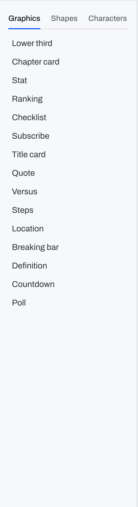

## 4. Changing the words

Click a graphic in the timeline (or on the preview) to select it. The **Content** tab shows a box for every piece of text in it. Type and the preview updates straight away.

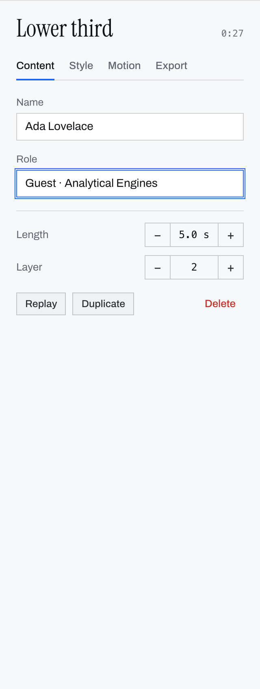

Under the text boxes:

- **Length** is how long the graphic stays on screen. Use − and + to change it, or drag the right edge of its block in the timeline.
- **Layer** controls what's on top when things overlap (see [section 9](#9-stacking-several-things-in-the-same-frame)).
- **Replay** plays the graphic from its start.
- **Duplicate** makes a copy just after it.
- **Delete** removes it.

To move a graphic to a different time, drag its block left or right in the timeline.

## 5. Changing how it looks

Open the **Style** tab. It has three sections. Click a section's name to fold it away.

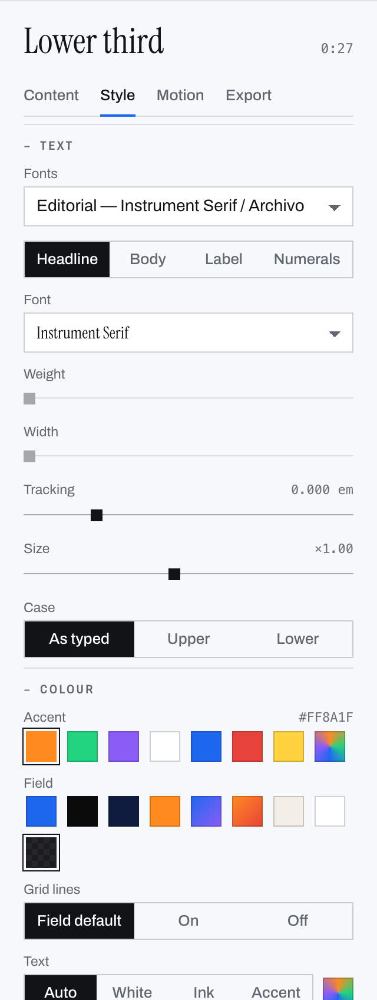

**Text**

- **Fonts** picks a matching set of fonts for the whole graphic. Try a few; it's the quickest way to change the feel.
- The four buttons below (**Headline**, **Body**, **Label**, **Numerals**) let you change one kind of text on its own: its font, weight (thin to bold), width, tracking (spacing between letters), size and capitals. **Reset** puts it back to the font set's choice.

**Colour**

- **Accent** is the highlight colour (the bar on a lower third, the badge on a stat). The last swatch opens a colour picker.
- **Field** is the background. **Clear** means no background, which is what you want for graphics that go over your footage.
- **Grid lines** turns the faint background grid on or off.
- **Text** and **Plates** set the text colour and the colour of the solid boxes behind text. **Auto** picks whatever reads best.

**Position**

- Click one of the nine squares to snap the graphic to that corner, edge or the centre of the safe area (the part of the screen that won't be cropped on any device).
- **Size** makes the whole graphic bigger or smaller.
- **Nudge X / Y** moves it a few pixels at a time.
- You can also drag the graphic around on the preview. Hold **Shift** while dragging to move in a straight line.
- **Reset** puts it back where it started.

## 6. Changing how it moves

Open the **Motion** tab.

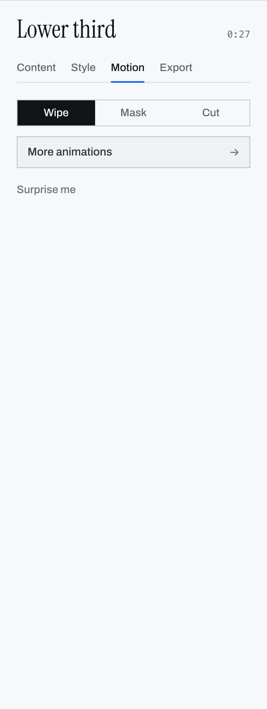

- **Wipe**, **Mask** and **Cut** are the three basic styles. Wipe slides on with a hard edge, Mask rises up into place, and Cut simply appears.
- **More animations** opens the full list of more than 400 styles.
- **Surprise me** picks one at random. Keep clicking until you like one.

**The animations list**

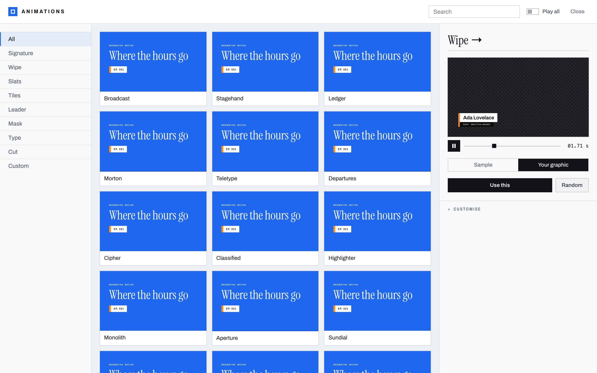

- Groups are on the left. Hover over any card to see it play. Turn on **Play all** to watch them all at once.
- Click a card to try it in the preview on the right. **Your graphic** shows it on the graphic you have selected; **Sample** shows it on a sample title.
- Click **Use this** to apply it. Double-clicking a card does the same.
- **Random** makes a brand new animation.
- **Customise** (at the bottom right) lets you fine-tune one: how it comes in and goes out, the easing (how it speeds up and slows down), the order its parts appear in, and the timing. Click **Save** to keep it; saved animations appear under **Custom**. **Export** and **Import** let you share them as files.

Click **Close** or press **Esc** to go back.

## 7. Shapes: arrows, boxes and callouts

Open the **Shapes** tab on the left. Shapes are for pointing things out: an arrow at a button, a box around a number, a circle around a face, a speech bubble.

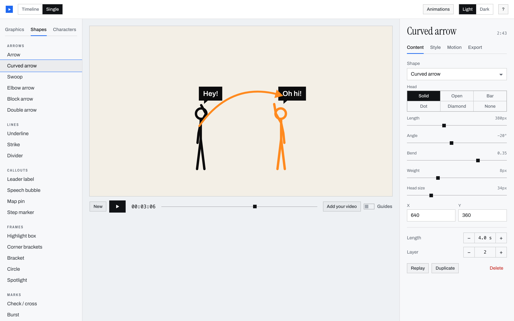

Click one to add it. The Content tab then shows everything you can change about it: length, angle, how much it bends, line thickness, arrowhead style, and so on. Some shapes also have a **Label** box for text.

To position a shape, drag it on the preview, or type exact **X** and **Y** values (the centre of the shape, in pixels from the top-left of a 1280 × 720 frame).

Shapes draw themselves on: lines grow from start to end, and arrowheads appear when the line reaches them.

## 8. Characters

Open the **Characters** tab on the left. Each item is a short scene with stick figures. Pick one to start.

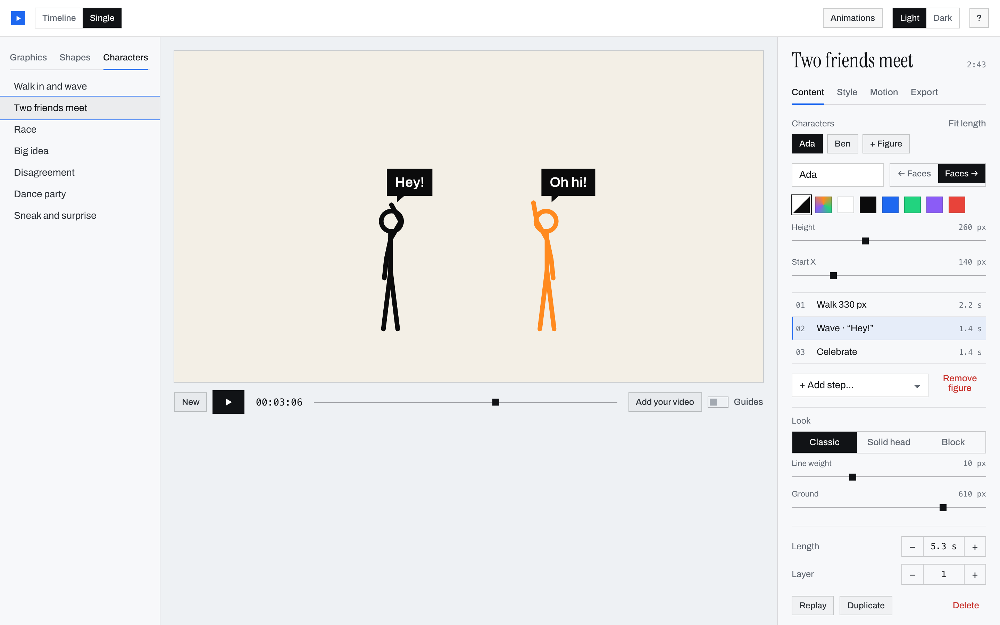

Select the scene and its Content tab shows:

- **Characters:** one button per figure. Click a figure to edit it. **+ Figure** adds another (up to six).
- Name, which way it faces, its colour, height and starting position.
- **Steps:** the list of things this figure does, in order. Click a step to open it:
  - pick an action (walk, run, jump, wave, point, cheer, dance, sit, fall over and more),
  - set how long it takes,
  - for walking, running or sneaking, set how far to go (negative goes backwards),
  - type what it **Says…** to show a speech bubble during that step,
  - optionally make it turn around first,
  - move the step up or down, duplicate it or delete it.
- **+ Add step…** adds a new action to the end.
- **Fit length** makes the clip exactly as long as the longest figure's steps.
- **Look** changes the drawing style, line weight and where the ground is.

The step that's playing right now is highlighted, so you can see where you are.

You don't need to pose anything by hand. Walking feet stay planted on the ground, and each action blends smoothly into the next. If you do want a specific pose, add a **Custom pose** step and use its sliders.

## 9. Stacking several things in the same frame

You can have several graphics on screen at once, for example a lower third over a chart with an arrow pointing at it.

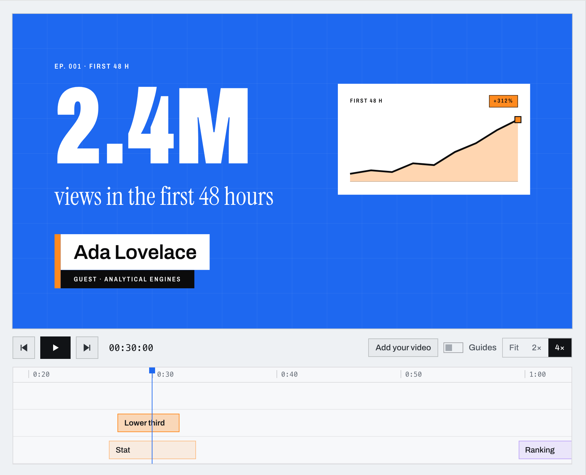

- **Adding:** if you add something at a moment where another graphic is already on screen, it goes on a new layer above it automatically.
- **Order:** higher rows in the timeline are on top. To change the order, drag a block up or down, or use **Layer** − / + in the Content tab.
- **Backgrounds:** only the bottom graphic shows its background; everything above it is drawn without one, so you can see through to the layers below. To have no background at all, set the bottom graphic's Field to **Clear**.
- **Exporting:** when you export a graphic that overlaps others, the whole stack is exported together as one file.

## 10. Checking it on your own video

Click **Add your video** under the preview and choose a video or a still image from your computer. It appears behind your graphics so you can check positions and sizes against the real shot. It stays on your computer and isn't changed.

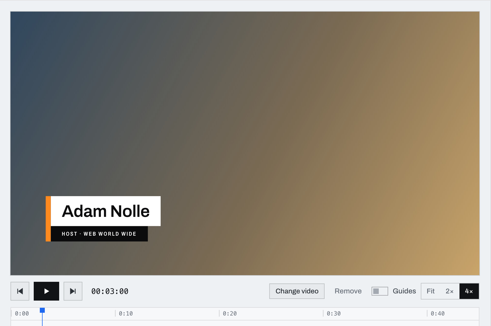

Your video shows through wherever the bottom graphic's Field is set to **Clear**. **Change video** picks a different one; **Remove** takes it away.

> Your video isn't saved with the project. Add it again after reopening the app.

## 11. Timeline and Single

The switch at the top left changes how you work:

- **Timeline** shows a whole video: the timeline, the transcript and every graphic at its moment. Use this when you're adding graphics to an episode.
- **Single** shows one animation on its own, looping, with no timeline or transcript. Use this when you just want to make a single animated graphic to export. Click **New** to start a fresh one; anything you add after that is stacked into it. The slider next to the time lets you scrub through it.

## 12. Exporting

Select a graphic and open the **Export** tab.

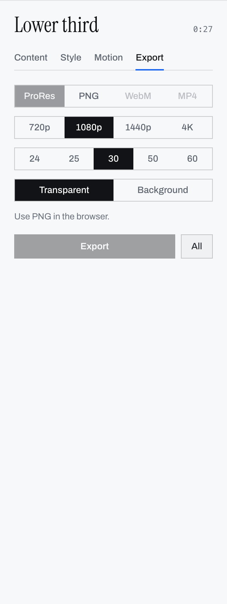

Choose:

1. **Format**
   - **ProRes** (`.mov`): the best choice for Premiere Pro, DaVinci Resolve and Final Cut Pro. Supports a transparent background.
   - **PNG**: a folder of numbered images, one per frame. Works in almost every editor and doesn't need ffmpeg. Supports a transparent background.
   - **WebM** (`.webm`): smaller files, for web and some editors. Supports a transparent background.
   - **MP4** (`.mp4`): plays everywhere but can't be transparent. Use it for previews or for graphics with a full background.
2. **Size:** match your video. 1080p is standard HD; 4K is for 4K projects.
3. **Frames per second:** match your video (usually 30, 25 or 24; 60 for smooth gameplay or sports footage).
4. **Transparent** or **Background:** Transparent leaves everything around the graphic see-through, so your footage shows. Background includes the coloured field.

Then click **Export** and choose where to save. **All** exports every graphic into a folder you choose, one file each.

The list under the buttons shows progress. You can keep working while it exports, and **Cancel** stops it.

If the video formats are greyed out, ffmpeg isn't installed (see [section 1](#1-install-and-open-the-app)).

## 13. Putting it into your video editor

The idea is the same everywhere: put your footage on the bottom track and the Webimation file on a track above it, at the moment you want it to appear.

**Premiere Pro**

1. **File → Import** and choose the `.mov`.
2. Drag it onto track **V2**, above your footage on V1.

For a PNG sequence, import the first image and tick **Image Sequence** in the import window.

**DaVinci Resolve**

1. Drag the `.mov` into the Media Pool.
2. Drag it onto the timeline on **Video 2**, above your footage.

Transparency is picked up automatically. A PNG folder shows up as a single clip when you add the folder.

**Final Cut Pro**

1. **File → Import → Media** and choose the `.mov`.
2. Drag it above your main clip so it connects on top.

Use ProRes for Final Cut; it doesn't import PNG sequences directly.

**CapCut and other apps**

Import the file and add it as an overlay above your footage. Support for transparent video differs between apps and versions. If the background shows up black, try the other transparent formats (ProRes, WebM or PNG), or export with **Background** and use the app's blending or cropping instead.

## 14. Saving your work

There's no save button: everything you do is saved automatically on your computer and is there when you reopen the app. Animations you save from the Customise panel are kept too.

To move work to another computer, export the graphics you need. To share a custom animation, use **Export** in the Customise panel and send the file.

## 15. Keyboard shortcuts

| Key | Does |
|---|---|
| Space | Play / pause |
| ← → | Back / forward one frame |
| Shift + ← → | Back / forward one second |
| [ ] | Jump to the previous / next graphic |
| Delete | Remove the selected graphic |
| M | Open the animations list |
| ? | Show the quick help |
| Esc | Close a window, or cancel picking a transcript word |

Shortcuts don't fire while you're typing in a text box.

## 16. Problems and fixes

**The Mac says the app can't be opened or checked.** Right-click it in Applications and choose **Open**. See [section 1](#1-install-and-open-the-app).

**ProRes, WebM and MP4 are greyed out.** ffmpeg isn't installed, or the app was open while you installed it. Install ffmpeg and restart Webimation.

**My exported graphic has a black background in my editor.** Check that you exported with **Transparent** selected and a transparent format (ProRes, PNG or WebM, not MP4). In Resolve and Premiere, ProRes transparency works without extra steps; in other apps, try PNG.

**The graphic doesn't show over my video in the preview.** Set the bottom graphic's **Field** (Style → Colour) to **Clear**.

**Text is cut off or in the wrong place.** Use Style → Position to move it back into the safe area, or reduce the size. Turn on **Guides** under the preview to see the safe area.

**I added something and it ended up on top of another graphic.** That's stacking (see [section 9](#9-stacking-several-things-in-the-same-frame)). Drag its block to a different time in the timeline, or delete it and add it somewhere empty.

**The transcript isn't my video's transcript.** The transcript is a sample. Importing your own transcript isn't supported yet, but you can still move the playhead anywhere on the timeline and add graphics there.

**The timeline is only three minutes long.** The timeline currently has a fixed length of three minutes. For longer videos, make each graphic in **Single** mode, export it, and place it in your editor.

## 17. Words used in this guide

- **Graphic:** anything you add: a title, a number, a shape or a character scene.
- **Playhead:** the blue line in the timeline showing the moment being previewed.
- **Layer:** a row in the timeline. Higher layers are drawn on top.
- **Stack:** graphics that overlap in time. They play and export together.
- **Field:** a graphic's background.
- **Clear:** no background, so whatever is behind shows through.
- **Accent:** the highlight colour.
- **Safe area:** the middle part of the screen that won't be cropped on phones and TVs.
- **Transparent:** see-through. A transparent export only contains the graphic itself.
- **ProRes / PNG / WebM / MP4:** file formats (see [section 12](#12-exporting)).
- **ffmpeg:** a free tool Webimation uses to make video files.
